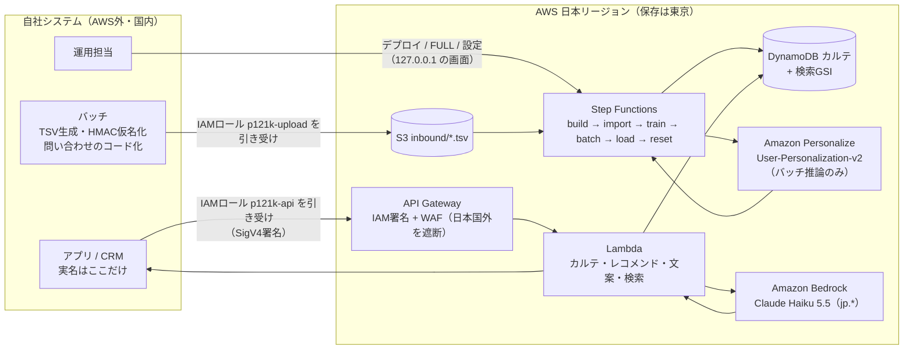

# P121K — Personalized One-to-One Karte

自社AWS（日本リージョン）に顧客1人1人の「カルテ」を持ち、Amazon Personalize v2 でレコメンドを作り、Bedrock で汎用の案内文案（メール・手紙・LINEなど媒体を問わない）を作る基盤。
メール配信機能・CMSは作らない。結果は自社サーバが IAM 署名付きAPIで取得する。

初めての方向け: **[クイックスタート（クローンから動作確認まで）](./docs/quickstart.md)**

## なぜ作ったか（開発のきっかけ）

個人メディア [homepage-v2](https://github.com/okamoto53515606/homepage) を開発・運用している。
その [blueprint](https://github.com/okamoto53515606/homepage/blob/main/docs/blueprint.md) に
「レコメンドによる『再来訪』の促進」が掲げられているが、**全く手つかず**だった。

homepage-v2 の立ち位置はこう整理されている。

| 評価軸 | 既存の常識 | homepage |
| :--- | :--- | :--- |
| 収益モデル | 広告モデル vs サブスク（継続課金） | **都度課金（少額決済後にN日間見放題）** |
| ユーザー維持 | 離脱防止施策による「囲い込み」 | **レコメンドによる「再来訪」の促進** |
| 利益構造 | 利益率の最大化 | **手数料負けも実験の一部**（Stripe手数料構造との戦いもコンテンツ化） |

そこで、特定のメディアに依存しない**汎用の分析・レコメンドの仕組み**を先に用意することにした。
homepage-v2 の思想（売り手都合ではなく利用者のことを考える）に、
**利用者一人一人に向き合う**というテーマを重ねて、
**Persolized One To One Karte → p121k** と名付けた。

## 設計原則

原則は「○○を防ぐために、●●する」の形で書く。守る/守らないを判定できないものは原則にしない。

### アクセス
1. **外部からの直接アクセスを防ぐために、APIは IAM 認証（SigV4）のみにする。** ブラウザ向けの公開APIは作らない。署名なしは403。送信元IP制限も任意で付けられる（`allowedCidrs`）。
2. **認証情報の漏えいを防ぐために、長期アクセスキーを使わず、IAMロールだけで呼び出す。** 呼び出し側には最小権限のマネージドポリシー（`karte-api-invoke` / `karte-inbound-upload`）だけを付ける。**利用システム側でのアクセスキー運用は禁止**（このスタックは IAM ユーザーもキーも作らない）。
3. **他のデータとの混在を防ぐために、単一社・専用アカウント・専用KMSキーにする。** マルチテナントにしない。

### データの最小化
4. **個人情報の漏えい被害を防ぐために、個人情報を AWS に置かない。** 氏名・メール・住所・電話、年代・都道府県などの粗い属性も持たない。会員IDは自社側で HMAC により仮名化してから送る（鍵は自社保管）。
5. **自由記述の混入を防ぐために、問い合わせは分類コードだけを送る。** `complaint / question / request / other`、`other` のときだけ40字以内の概要。40字超・未知のカテゴリ・想定外の列（`body` など）は拒否する。
6. **Bedrock に個人情報を渡さないために、そもそも AWS に個人情報を置かない（原則4）。** プロンプトに載るのは商品名・カテゴリ・購入回数・興味カテゴリだけで、宛名は `{{customer_name}}` のプレースホルダ固定。実名の差し込みは自社サーバが行う。伏字化（電話・メール等の形式置換）は「万一混入したとき」の保険として残しているが、主防御は最小化。

### データの残存
7. **退会者のデータ残存を防ぐために、退会 = 存在しない、にする。** S3 の行動履歴に `withdraw` が1行でもある会員は、**全履歴ごと**カルテにも学習データにも入れない。退会状態のレコードや墓標を持たない。
8. **古いデータの残存を防ぐために、直近N年だけ保持する。** S3ライフサイクルで古いファイルを自動削除し、FULL再構築も期限切れの行を無視する（`retentionYears`、既定3年）。
9. **削除の復活を防ぐために、即時削除でも S3 に `withdraw` を記録する。** `DELETE /karte/{id}` はカルテを即時に消し、同時に `withdraw` 行を S3 に書く。次回以降のFULLでも復活しない。
10. **状態のずれ・差分バグを防ぐために、毎回FULLで作り直す。** 週1想定で S3 の全履歴を読み直し、DynamoDB のカルテと Personalize の入力を丸ごと入れ替える。差分管理・排他制御・状態遷移を持たない。

### 判定と生成
11. **説明できない接触判断を防ぐために、接触NGはルールだけで決める。** LLMは判定に使わない。NG理由は `RETURN_SPIKE`（30日内に返品2件以上）/ `RECENT_COMPLAINT`（30日内にクレーム）/ `NO_KARTE`（カルテなし）。
12. **NG会員への接触を防ぐために、404（カルテなし）もNGとして扱う。** NG会員にはレコメンドを返さず、文案生成は409で拒否する。
13. **不正データによるカルテ破損を防ぐために、厳密なスキーマ検証を行う。** 列の過不足はファイルごと、不正な値は行ごとに拒否し、`reports/<run>/rejects.csv` に記録する。同一行の重複は排除する。

### 暗号化・通信・コスト
14. **保管データの漏えいを防ぐために、S3・DynamoDB は専用KMSキー（CMK）で暗号化し、TLSのみ許可、パブリックアクセスを全ブロックする。**
15. **意図しない常時課金を防ぐために、Personalize はバッチ推論だけを使う。** リアルタイムCampaignは作らない（無リクエストでも最低1TPS分が課金される）。
16. **データの国外流出を防ぐために、AWS の日本リージョン（東京・大阪）だけで完結させる。** 保存先は東京。Bedrock は `jp.*` 推論プロファイル（東京・大阪のみ）を使う。API は WAF の国判定で日本国外からの呼び出しを遮断する。
17. **構築と検証のずれを防ぐために、全リソースを CDK でコード化し、セキュリティ性質を CDK テストで検証する。**

## 全体構成



- **個人情報（氏名・住所・電話・メール・問い合わせ本文）は AWS に入らない。** 自社側で HMAC 仮名化・コード化したものだけを置く。
- 保存先は東京。Bedrock だけは日本向け推論プロファイル（東京・大阪）を使う。
- 自社システムは AWS の外（国内）にあり、S3 への PUT と API 呼び出しの2経路だけを持つ。

## 利用イメージ（実データ）

テストデータ（1.5万会員・約24万イベント）で実際に返ってきたレスポンス。

### カルテを取る — `GET /karte/{memberId}`

```json
{
  "member_id": "62b8bbb57707f3c2c13eb56a9865a8bf",
  "updated_at": 1795382991,
  "last_event_ts": 1569922559,
  "counts": {
    "purchase": 2,
    "view": 8,
    "like": 0,
    "cart": 0,
    "return": 0
  },
  "last_ts": {
    "purchase": 1569910881,
    "view": 1569922559
  },
  "recent_events": [
    {
      "type": "view",
      "item_id": "4804056",
      "ts": 1569911079
    },
    {
      "type": "view",
      "item_id": "4804056",
      "ts": 1569913826
    },
    {
      "type": "view",
      "item_id": "4804056",
      "ts": 1569922559
    }
  ],
  "purchases": [
    {
      "item_id": "4804056",
      "price": 24297,
      "ts": 1569908004
    },
    {
      "item_id": "4804056",
      "price": 24297,
      "ts": 1569910881
    }
  ],
  "returns": [],
  "inquiry_count": 1,
  "inquiries": [
    {
      "note": "ポイント失効についての相談",
      "id": "Q0000321",
      "category": "other",
      "ts": 1569857759
    }
  ],
  "first_purchase_ts": 1569908004,
  "last_purchase_ts": 1569910881,
  "first_view_ts": 1569907828,
  "last_view_ts": 1569922559,
  "purchase_count_30d": 2,
  "purchase_count_90d": 2,
  "purchase_count_180d": 2,
  "view_count_30d": 8,
  "view_count_90d": 8,
  "view_count_180d": 8,
  "reco": {
    "generated_at": 1795386332,
    "items": [
      {
        "category": "electronics.audio.headphone",
        "item_id": "4804056",
        "item_name": "apple headphone #4804056",
        "price": 24297,
        "score": "0.7959431"
      },
      {
        "category": "electronics.audio.headphone",
        "item_id": "4804055",
        "item_name": "apple headphone #4804055",
        "price": 28310,
        "score": "0.0748569"
      },
      {
        "category": "electronics.audio.headphone",
        "item_id": "4802036",
        "item_name": "apple headphone #4802036",
        "price": 25734,
        "score": "0.0663173"
      }
    ],
    "model": "arn:aws:personalize:ap-northeast-1:123456789012:solution/karte-up-v2/97d60ecd"
  },
  "copy": null,
  "top_categories": [
    "electronics.audio.headphone"
  ],
  "contact": {
    "ok": true,
    "reasons": []
  }
}
```

- `purchases` / `returns` / `inquiries` は **S3 に置いた分すべて**。`price` はアイテムマスタの最新単価。
- 検索用に `first_purchase_ts` / `last_purchase_ts` / `*_count_90d` なども返す（一覧検索と同じ値）。
- `contact.ok=false` なら接触NG（`RETURN_SPIKE` / `RECENT_COMPLAINT` / `NO_KARTE`）。カルテが無ければ 404。
- `reco` は FULL（Personalize）完了後に `items[]` と `model`（Solution Version）が入る。`price` はアイテムマスタの単価。
- `copy` は `POST /karte/{id}/copy` を呼んだ後に埋まる（呼ぶまでは `null`）。呼ぶたびに上書きされ、FULL 再構築でも保持される。上の例は未生成の会員。

### 文案を作る — `POST /karte/{memberId}/copy`

```json
{
  "member_id": "85140284181aa2e01985878b055f5de0",
  "copy": {
    "subject": "{{customer_name}}様へ、新しいノートパソコンのご案内",
    "body": "いつもご利用いただきありがとうございます。{{customer_name}}様にお役立ていただけるよう、最新のノートパソコンをご紹介させていただきたくご連絡いたしました。\n\n前回のご購入からしばらく経ちましたが、いかがお過ごしでしょうか。この度、性能と使いやすさを兼ね備えた新しいモデルが入荷いたしました。\n\nご来店いただいた際には、スタッフが丁寧にご説明させていただきます。ご不明な点やご質問がございましたら、いつでもお気軽にお問い合わせください。\n\nご来店をお待ちしております。",
    "model": "jp.anthropic.claude-haiku-4-5-20251001-v1:0"
  }
}
```

- 宛名は `{{customer_name}}` のまま返る。実名の差し込みは自社サーバが行う（AWS に実名を置かない）。
- `direction` で訴求点・文体・長さを指示できる。上の例は
  `direction: "しばらく購入が無いので再来店を促す。クーポンの断定は避ける。絵文字なし。200字程度"`。
- 上の実行は **Haiku 4.5** で行ったもの（5.5 はアカウントのモデルアクセス付与待ち）。実装は 5.5 前提で、自動フォールバックはしない。

## ソースデータ仕様（S3 PUT、UTF-8 TSV、ヘッダ付き）

詳細は [docs/s3-spec.md](./docs/s3-spec.md)。API は [docs/api-spec.md](./docs/api-spec.md)。

パス: `s3://<Bucket>/inbound/{items|events|inquiries}/<任意名>.tsv`（タブ区切り。`.csv` は受け付けない）

| 種別 | 列（[ ]は任意） | 備考 |
|---|---|---|
| items | `item_id	item_name	[item_description]	category	price` | 最新ファイルが全件スナップショット |
| events | `member_id	item_id	event_type	event_ts	[reason]` | `event_type`: `view/like/cart/purchase/return/withdraw`。`event_ts`はISO8601(タイムゾーン付き)。`withdraw`は`item_id`空欄。ファイルは**追記**し、`withdraw`行は消さない |
| inquiries | `inquiry_id	member_id	received_ts	category	[note]` | 上記原則5 |

`member_id` は **HMAC-SHA256 の16進（32/64桁）のみ**。生のIDは行単位で拒否される（[docs/s3-spec.md](./docs/s3-spec.md) の HMAC 仕様）。

Personalize には `view/like/cart/purchase` だけを渡す（`return` は学習に使わない）。最低 1,000 インタラクション / 25 ユーザー必要。

カルテには **購入・返品・問い合わせを全件**保存する（金額はアイテムマスタの最新単価）。一覧検索は `GET /karte/search`（GSI）で行う。

## 使い方

**セットアップ画面（推奨）** — ブラウザからデプロイ・運転・削除まで行えます。

```bash
bash setup/start.sh
# → http://127.0.0.1:3011（Basic 認証。ID / パスワードは起動時に表示）
```

画面の構成: 0. AWS 接続 → 1. 設定（保持年数・週次・通知先） → 2. デプロイ → 3. データのPUT（何をどのパスに置くか） → 4. FULL の実行 → 5. 社内システム連携（API） → 6. 削除。
アクセスキーは**サーバのメモリにのみ保持**し、ディスクには書きません（再起動時は再入力）。
詳細とセキュリティ設計は [setup/README.md](./setup/README.md)。

設定はすべて画面から行えます（保持年数・週次 FULL・通知先・IP 制限・監査・モデル）。
コマンドラインで同じ値を使う場合の一覧は [docs/operations.md](./docs/operations.md) を参照してください。

## 運用

1. **PUT**: 自社サーバが `p121k-upload` ロールを引き受け（インスタンスプロファイル / タスクロール / Roles Anywhere）、`karte-inbound-upload` の権限で上記パスへ。
2. **FULL実行**: Step Functions `karte-reco-pipeline` を起動（学習込みで実証規模で約1時間）。buildだけ試すときは Lambda `Pipeline` に `{"action":"build"}`。
3. **API呼び出し**: 呼び出し側が `p121k-api` ロールを引き受け、SigV4で署名する（長期キーは使わない）。ロールは S3 用と API 用で分かれている。
4. **退会**: events に `withdraw` を追記する。急ぐ場合は `DELETE /karte/{id}`。
5. **後片付け**: 画面の「6. 削除」を使う。Personalize の Solution / Solution Version は残るため、不要なら `docs/operations.md` の手順で削除する。

障害時の見方、監視項目、規模の切り替えは [docs/operations.md](./docs/operations.md) を参照。
自社側（PUTする側）の参考実装は `tools/ingest_side.py`（HMAC仮名化・問い合わせの分類コード化・withdraw出力）。
入出力の実例（TSV）は `docs/samples/` にある。

## 検証済みの内容（2026-11-22、ap-northeast-1、実証データ1.5万会員・約24万イベント）

- FULL build 約30秒。接触NG判定は正解データと全件一致。退会者469名はカルテにも学習データにも存在しない。
- `DELETE` 後にFULLを回しても復活しない。署名なしAPIは403。
- 不正行・不正ファイルは拒否され、電話番号などの全文はカルテに残らない。
- Personalize 全パイプライン成功（学習 約40分）。14,359名にTop-10を反映し、退会者・NG会員への反映は0。
- 署名付きでも `karte-api-invoke` を持たない IAM ユーザーは 403。APIアクセスログとLambdaログに会員IDは残らない（`member_tag` のみ）。
- 障害通知（SNS `karte-alerts`）とデータ品質アラーム（拒否行・スキップファイル）がデプロイされ、build のメトリクス（名前空間 `P121K`）が CloudWatch に届くことを確認。
- 取込は **TSV**。`member_id` は HMAC の16進のみ受け付け、生のIDは行単位で拒否されることを確認。
- カルテは購入・返品・問い合わせを**全件**保持し、購入/返品にはアイテムマスタの単価が付く。
- 一覧検索 `GET /karte/search` が GSI で動作（最終購入が近い／購入回数90日がN以上 など）。

## データ出典とライセンス

| データ | 扱い |
|---|---|
| [REES46 eCommerce behavior data](https://www.kaggle.com/datasets/mkechinov/ecommerce-behavior-data-from-multi-category-store)（Kaggle） | **採用**。作者が「無料で利用可。KaggleページとREES46へのリンクを出典として明記」と記載（`https://rees46.com`）。Kaggleのlicense欄は "Data files © Original Authors" で正式なOSSライセンスではないため、検証用に限定。データはリポジトリに含めない |
| Olist Brazilian E-Commerce / Retailrocket | **不採用**。CC BY-NC-SA 4.0（非商用） |
| Amazon Reviews 2023 | **不採用**。ライセンス記載が確認できない |
| 商品名・説明・like・return・withdraw・問い合わせコード | **合成**（`tools/prepare_data.py`、ルールベース） |

## モデルとコストの要点

- Claude Haiku 5.5 の東京単独推論は無く、日本向け推論プロファイル `jp.anthropic.claude-haiku-5-5`（東京・大阪）のみ。
- 単価（Bedrock の Marketplace オファーの料金表で確認済み）: 日本向けプロファイルは入力 $0.11 / 出力 $0.55 /100万トークン（グローバルは $0.10 / $0.50）。100Kトークン超は入力 $0.55 / 出力 $2.75。
- **Haiku 5.5 は Bedrock のバッチ推論に対応していない**（`CreateModelInvocationJob` が `Batch inference is not supported for the requested model` で拒否することを実機で確認）。文案生成は即時API（`POST /copy`）のみ。
- 利用には Marketplace の契約（従量課金・返金なし）への同意が必要。**モデルの代替切替は実装していない**。Haiku 5.5 が使えない場合は `POST /karte/{id}/copy` がエラーを返す（黙って別モデルに変わらない）。
- 契約は `aws bedrock create-foundation-model-agreement --model-id anthropic.claude-haiku-5-5 --offer-token <list-foundation-model-agreement-offers の token>` で作成できる（2026-11-22 に ap-northeast-1 で作成済み）。
- 契約直後は **アカウント検証待ち**で、推論は `AccessDeniedException` になる。ap-northeast-3 では「Your account is currently being verified. Verification normally takes less than 2 hours.」と明示されるが、ap-northeast-1 では「is not available for this account」という紛らわしい汎用文言になる。`tools/probe_haiku55.py` で利用可能になるまで確認できる。
- Personalize v2: 取込 $0.05/GB、学習 $2.00/100万インタラクション、推論 $0.15/1,000リクエスト。FULL再学習は毎回全件が学習課金の対象。

## 注意

- `data/`（元データ・HMAC鍵・正解ラベル・デプロイ出力）は git 管理外。アップロード・コミット禁止。
- Personalize Schema は**タグ変更で置換され、名前衝突して失敗**する。スタックのタグを変えない。

## ライセンス

このリポジトリのコードは [MIT License](./LICENSE)。

同梱しないデータの扱いは次のとおり。

| 対象 | ライセンス / 条件 |
|---|---|
| REES46 eCommerce behavior data | 作者の記載に従う（出典明記）。正式な OSS ライセンスではないため、検証用途に限定し、リポジトリには含めない |
| 生成したサンプル（`docs/samples/`） | 本リポジトリと同じ MIT（合成データのみ） |
| Claude Haiku 5.5 / Amazon Personalize | 各サービスの利用規約に従う（コードのライセンスとは別） |
