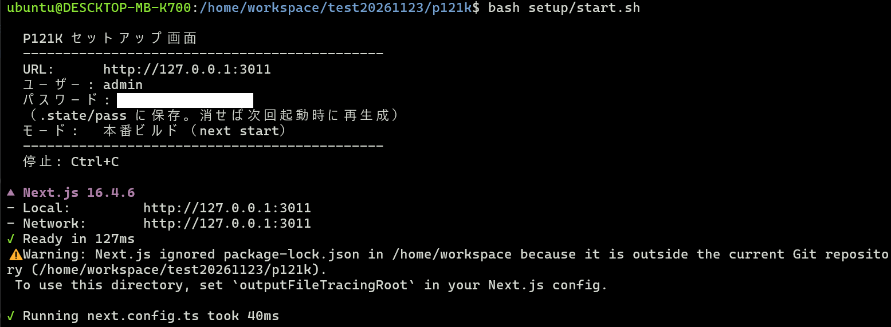
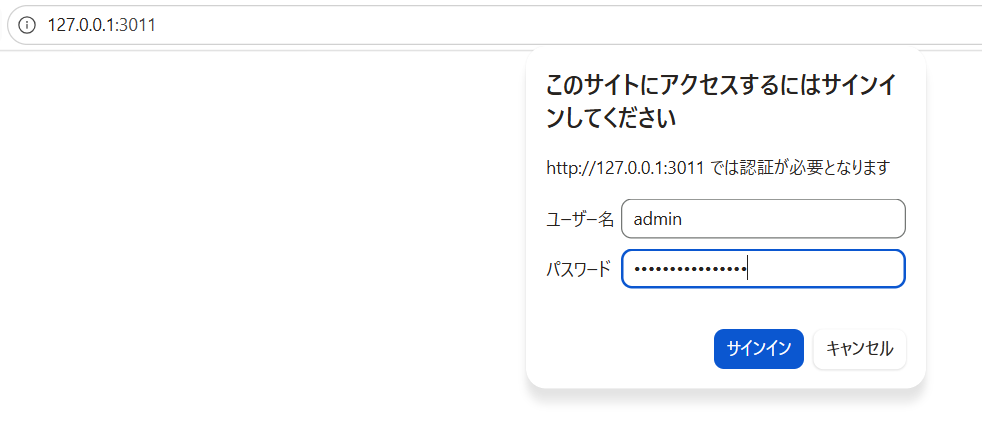
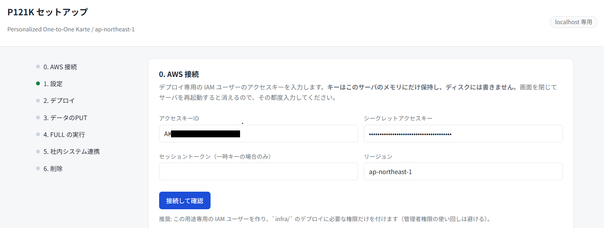
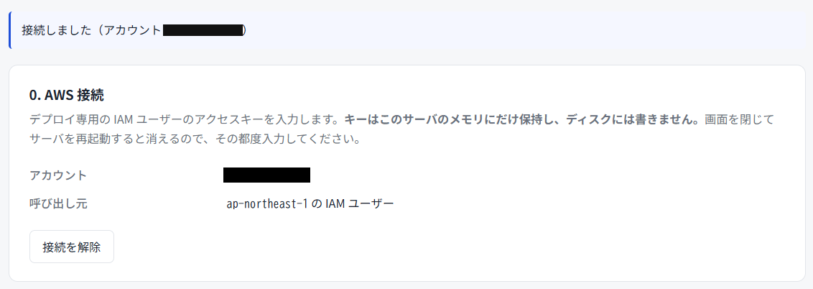
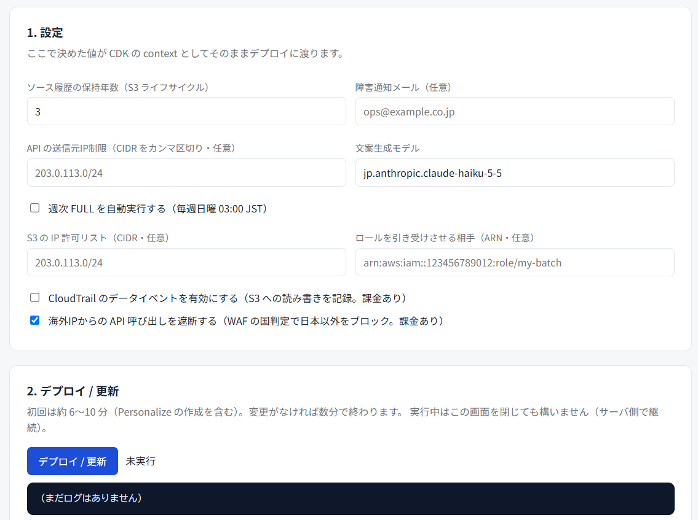
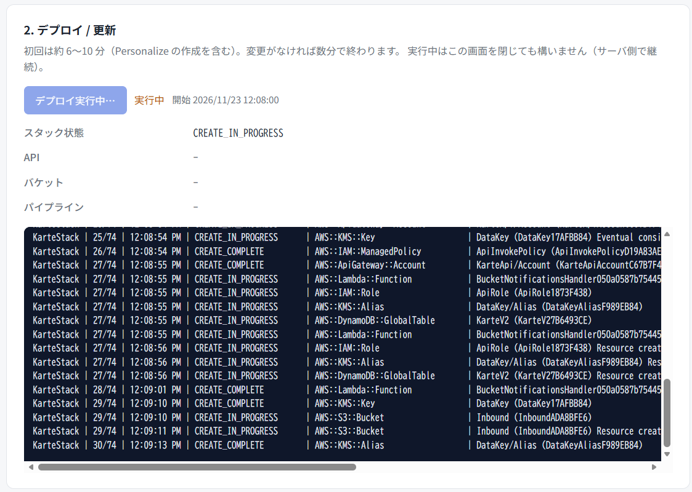
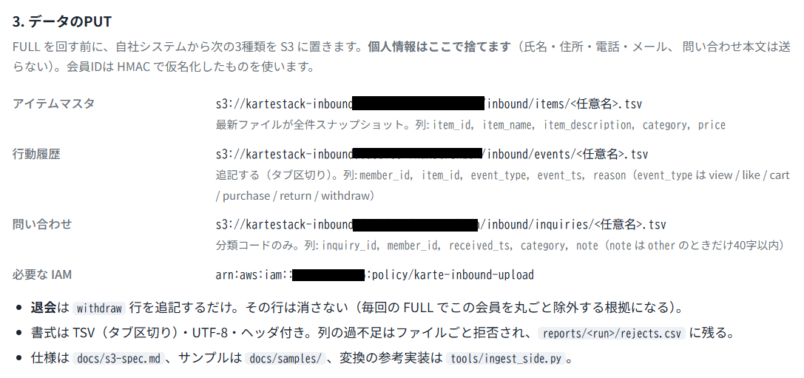
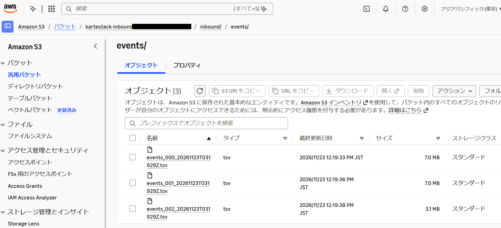
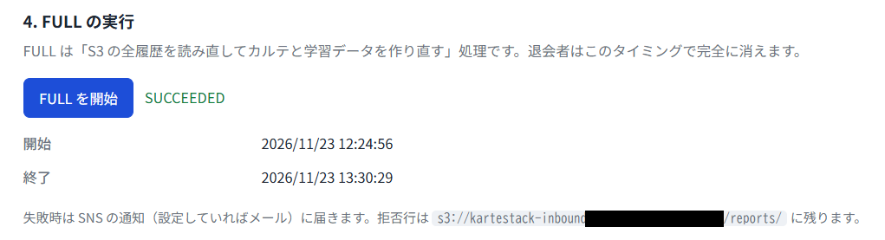

# クイックスタート（クローンから動作確認まで）

このガイドは、**手元の PC から `git clone` して、AWS にデプロイし、API でカルテを取得するまで**を通しで説明します。
所要時間は約 30 分（Personalize の学習を含めると約 1.5 時間）。

> 対象: AWS アカウントを持ち、ターミナル操作ができる方。
> 設計の考え方は [README](../README.md)、データ仕様は [s3-spec](./s3-spec.md)、API は [api-spec](./api-spec.md) を参照。

---

## 0. 前提

| 必要なもの | 確認コマンド | 目安 |
|---|---|---|
| AWS アカウント | `aws sts get-caller-identity` | デプロイ可能な権限 |
| AWS CLI v2 | `aws --version` | 2.x |
| Node.js | `node -v` | 20 以上（CDK と画面で使用） |
| Python | `python3 -V` | 3.10 以上 |
| git | `git --version` | 任意 |

デプロイ先は **ap-northeast-1（東京）** 固定です。

```bash
aws configure --profile p121k
export AWS_PROFILE=p121k AWS_REGION=ap-northeast-1
aws sts get-caller-identity
```

> ここで入力する AWS 認証情報は**デプロイ作業者用**です。アプリの利用者向けの長期キーは作りません（[iam-for-callers](./iam-for-callers.md)）。

---

## 1. クローンと依存関係

```bash
git clone https://github.com/okamoto53515606/p121k.git
cd p121k

# Python（テストと補助ツール）
python3 -m venv .venv
.venv/bin/pip install -q boto3 pytest moto

# CDK（インフラ）
cd infra && npm install && cd ..

# セットアップ画面
cd setup && npm install && cd ..
```

### 改行コードは LF のまま使う（エラー防止）

`setup/start.sh` などのスクリプトは **LF 前提**です。`core.autocrlf=true` の PC（Windows の既定など）ではチェックアウト時に CRLF へ変換され、`set: pipefail: invalid option name` で起動できません。

本リポジトリは `.gitattributes` で LF に固定してあるため通常はそのまま動きますが、次の 2 コマンドで確認できます。

```bash
git config --get core.autocrlf   # 何も出なければ既定。true でも .gitattributes が優先されます
file setup/start.sh              # "with CRLF line terminators" と出たら下記で修正
```

古い clone をそのまま使っていて CRLF になっている場合は、次のどちらかで直します。

```bash
sed -i 's/\r$//' setup/start.sh                              # その場で直す
git -c core.autocrlf=false clone https://github.com/okamoto53515606/p121k.git   # 取り直す
```

---

## 2. セットアップ画面を起動する

```bash
bash setup/start.sh
```

起動すると、URL とログイン情報が表示されます。



```
  P121K セットアップ画面
  ---------------------------------------------
  URL:      http://127.0.0.1:3011
  ユーザー: admin
  パスワード: （自動生成。setup/.state/pass に保存）
  モード:   開発モード（next dev / 初回アクセス時にコンパイル）
```

ブラウザで `http://127.0.0.1:3011` を開き、表示された ID / パスワードを入力します。



この画面は **127.0.0.1 のみ**で待ち受け、Basic 認証つきです（外部からは到達しません）。

> 表示を速くしたい場合は、本番ビルドを作っておくと次回起動から `next start` で立ち上がります（未ビルドなら自動で開発モード）。
>
> ```bash
> cd setup && npx next build && cd ..
> ```

---

## 3. AWS に接続する（画面 0）

デプロイ用のアクセスキーを入力し、「接続して確認」を押します。



- キーは**サーバのメモリにのみ**保持され、ディスクには保存されません。
- 画面を再起動すると再入力が必要です。

接続できると、画面の上部にアカウント ID が表示されます（下の画像ではマスクしています）。



---

## 4. 設定する（画面 1）

| 項目 | 初期値 | 説明 |
|---|---|---|
| 保持年数 | 3 | S3 のソース履歴を残す年数。FULL も古い行を無視する |
| 週次 FULL | オフ | オンにすると毎週日曜 03:00 (JST) に自動実行 |
| 通知メール | 空 | パイプライン失敗などを SNS からメール通知 |
| API の IP 制限 | 空 | 指定すると API を送信元 IP で制限 |
| モデル | `jp.anthropic.claude-haiku-5-5` | 文案生成に使うモデル。**Bedrock のモデルID / 推論プロファイルID をそのまま書く**（例: `jp.anthropic.claude-haiku-5-5`、`jp.anthropic.claude-haiku-4-5-20251001-v1:0`）。`aws bedrock list-inference-profiles` で確認できる |
| S3 の IP 許可リスト | 空 | 指定すると S3 への PUT をその CIDR だけに限定 |
| ロールを引き受けさせる相手 | 空 | 別アカウントのロールに許可する場合の ARN |
| CloudTrail | オフ | S3 への読み書きを記録（課金あり） |
| 海外 IP 遮断 | オン | WAF で日本国外からの API 呼び出しをブロック |



---

## 5. デプロイする（画面 2）

「デプロイ / 更新」を押します。初回は **6〜10 分**かかります。ログが流れ、完了すると API URL などが表示されます。




`✅ KarteStack` と出て、`Status: UPDATE_COMPLETE` になれば成功です。

---

## 6. データを PUT する（画面 3）

自社システム（AWS の外）から、**TSV** を S3 に置きます。まずはサンプルで試すのが早いです。

```bash
# サンプル（数行）をそのまま PUT する場合
aws s3 cp docs/samples/items.tsv     s3://<BucketName>/inbound/items/items_$(date +%s).tsv --sse aws:kms
aws s3 cp docs/samples/events.tsv    s3://<BucketName>/inbound/events/events_$(date +%s).tsv --sse aws:kms
aws s3 cp docs/samples/inquiries.tsv s3://<BucketName>/inbound/inquiries/inquiries_$(date +%s).tsv --sse aws:kms
```



S3 に置かれると、AWS コンソールの `inbound/` 以下で確認できます。



**注意点**

- 拡張子は `.tsv` のみ。`.csv` は取り込まれません（カンマを含む商品名で壊れるため）。
- `member_id` は **HMAC-SHA256 の16進（32桁）**。生の会員IDは行単位で拒否されます。
- 退会は `withdraw` 行を追記するだけ。その行は消さないでください。
- 列の定義は [s3-spec](./s3-spec.md) を参照。

> 大量のテストデータを作る場合: `python tools/prepare_data.py`（REES46 のサンプルから 1.5 万会員分を生成）。
> 既定で「最新イベントが昨日」になるよう日付を平行移動します。画面からのデプロイは保持期間と直近集計の基準日が「今日」なので、元の日付（2019 年）のままだと全件が保持期間外で捨てられます。元の日付を使いたいときは `--keep-dates`。

```bash
# 生成したデータをまとめて PUT する（<BucketName> は画面 2 の出力）
RUN=$(date +%Y%m%dT%H%M%S)
aws s3 cp data/out/items.tsv "s3://<BucketName>/inbound/items/items_$RUN.tsv" --sse aws:kms
for f in data/out/events_*.tsv; do
  aws s3 cp "$f" "s3://<BucketName>/inbound/events/$(basename "$f" .tsv)_$RUN.tsv" --sse aws:kms
done
aws s3 cp data/out/inquiries.tsv "s3://<BucketName>/inbound/inquiries/inquiries_$RUN.tsv" --sse aws:kms
```

---

## 7. FULL を実行する（画面 4）

「FULL を開始」を押します。S3 の全履歴を読み直してカルテを作り、Personalize で学習・推論します。


実行中は `RUNNING`、終わると `SUCCEEDED` と開始・終了時刻が並びます。



- 実証規模（1.5 万会員・約 24 万イベント）で **約 1 時間**（学習が大半）。
- 完了すると、各カルテに `reco`（おすすめ商品）が入ります。

---

## 8. API を呼ぶ（画面 5）

画面に、呼び出しに使うロール ARN とサンプルコマンドが表示されます。


**セルフテスト**: 画面の「API のセルフテスト」を押すと、署名なし（403）→ 署名あり（404/200）をその場で確認できます。

手元から試す場合は `p121k-api` ロールを引き受けて、SigV4 で署名します。

```bash
# 1) ロールを引き受ける（AWS 上ならインスタンスプロファイル等で自動）
CREDS=$(aws sts assume-role --role-arn <ApiRoleArn> \
  --role-session-name p121k-call --query Credentials --output json)
export AWS_ACCESS_KEY_ID=$(echo "$CREDS" | jq -r .AccessKeyId)
export AWS_SECRET_ACCESS_KEY=$(echo "$CREDS" | jq -r .SecretAccessKey)
export AWS_SESSION_TOKEN=$(echo "$CREDS" | jq -r .SessionToken)

# 2) カルテを取得（<ApiUrl> は画面 2 の出力、末尾の / を忘れずに）
curl -s --aws-sigv4 "aws:amz:ap-northeast-1:execute-api" \
  --user "$AWS_ACCESS_KEY_ID:$AWS_SECRET_ACCESS_KEY" \
  -H "x-amz-security-token: $AWS_SESSION_TOKEN" \
  "<ApiUrl>karte/<memberId>" \
  | jq '{contact, counts, reco_count: (.reco.items | length)}'
```

| 呼び出し | 期待される結果 |
|---|---|
| 署名なし `GET /karte/<id>` | 403 |
| 署名あり `GET /karte/<id>` | 200（`contact.ok` が接触可否、`reco` がおすすめ） |
| 退会・未登録・削除済み | 404（`contact.reasons` が `["NO_KARTE"]`） |
| `GET /karte/<id>/reco` | 200（接触NGなら `items` は空） |
| `POST /karte/<id>/copy` | 200（接触NGなら 409 `CONTACT_NG`） |
| `GET /karte/search?by=last_purchase&limit=10&older_than_days=30` | 200（該当件数と一覧） |

- 認証は IAM（SigV4）のみ。ブラウザからは呼べません（長期キーも使いません）。
- `curl --aws-sigv4` はクエリ文字列をそのまま署名するため、**`/karte/search` のパラメータはアルファベット順**に並べます（`by` → `limit` → `older_than_days`）。順序を変えると 403 `SignatureDoesNotMatch` になります。
- 文案生成は `POST /karte/<id>/copy` です。本文に `{"channel":"email","tone":"丁寧","direction":"来月の新商品を軽く紹介して返信を促す"}` のような指示を渡せます。

---

## 9. 後片付け

```bash
# 画面の「6. 削除」を押すか、CLI で:
cd infra && npx cdk destroy KarteStack --force
```

- S3 のデータ、DynamoDB のカルテ、KMS キーも削除されます。
- Personalize の Solution / Solution Version は残るため、不要なら手動で削除してください。

---

## よくあるつまずき

| 症状 | 対処 |
|---|---|
| `bash setup/start.sh` が `set: pipefail: invalid option name` で止まる | ファイルが CRLF になっています（`core.autocrlf=true` の PC）。「[改行コードは LF のまま使う](#改行コードは-lf-のまま使うエラー防止)」の手順で修正 |
| `Could not find a production build in the '.next' directory` で止まる | `next dev` が残した開発用の `.next` を本番ビルドと誤認していました（旧版の `start.sh`）。最新の `main` は `.next/BUILD_ID` の有無で判定します。手元で直すには `rm -rf setup/.next`（速くしたいなら `cd setup && npx next build`） |
| 画面が開かない | `bash setup/start.sh` の表示どおり `http://127.0.0.1:3011` か確認。ポート 3011 の競合に注意 |
| デプロイが `❌` で止まる | 画面のログ末尾を確認。多くは権限不足か、既存リソースとの名前衝突 |
| PUT したのにカルテが増えない | 拡張子が `.tsv` か、`member_id` が32桁の16進か。`reports/<run>/rejects.csv` を見る |
| FULL したのにカルテが 0 件 | イベントが保持期間外。画面からのデプロイは `policyReference=now` なので、古い日付のデモデータは全件捨てられます。`python tools/prepare_data.py`（既定で日付をシフト）で作り直すか、保持年数を延ばす |
| API が 403 | 署名なし／`p121k-api` ロールを引き受けていない／日本国外からのアクセス（WAF） |
| `POST /copy` が 502 | API Lambda のログを見る。`ValidationException: The provided model identifier is invalid` ならモデルIDの綴り違い（4.5 は `jp.anthropic.claude-haiku-4-5-20251001-v1:0` のように日付まで含む）。`AccessDeniedException` ならアカウントのモデルアクセス未付与。代替モデルへは切り替わらない |
