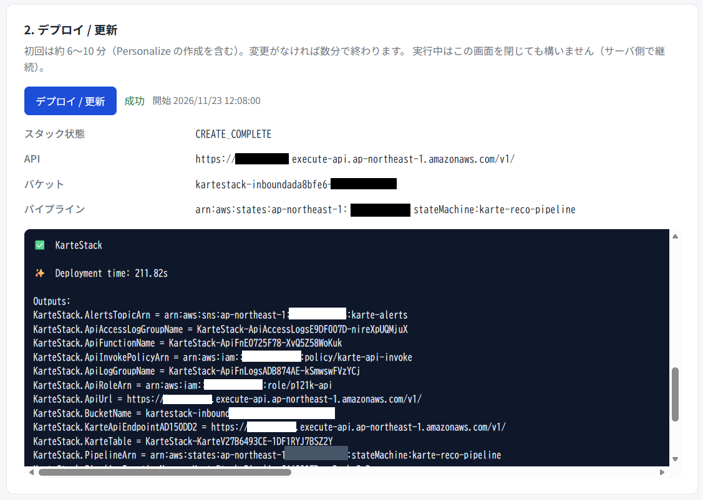
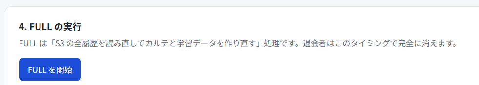
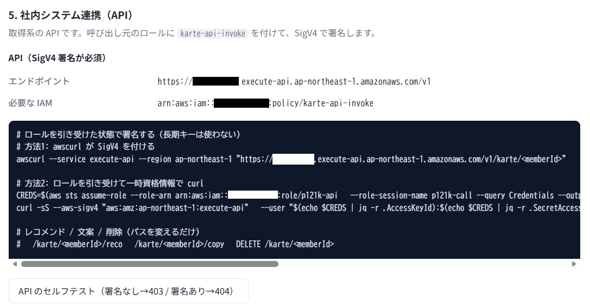

# クイックスタート（クローンから動作確認まで）

このガイドは、**手元の PC から `git clone` して、AWS にデプロイし、API でカルテを取得するまで**を通しで説明します。
所要時間は約 30 分（Personalize の学習を含めると約 1.5 時間）。

> 対象: AWS アカウントを持ち、ターミナル操作ができる方。
> 設計の考え方は [README](../README.md)、データ仕様は [s3-spec](./s3-spec.md)、API は [api-spec](./api-spec.md) を参照。

---

## 0. 前提

| 必要なもの | 確認コマンド | 目安 |
|---|---|---|
| AWS アカウント | `aws sts get-caller-identity` | デプロイ可能な権限 |
| AWS CLI v2 | `aws --version` | 2.x |
| Node.js | `node -v` | 20 以上（CDK と画面で使用） |
| Python | `python3 -V` | 3.10 以上 |
| git | `git --version` | 任意 |

デプロイ先は **ap-northeast-1（東京）** 固定です。

```bash
aws configure --profile p121k
export AWS_PROFILE=p121k AWS_REGION=ap-northeast-1
aws sts get-caller-identity
```

> ここで入力する AWS 認証情報は**デプロイ作業者用**です。アプリの利用者向けの長期キーは作りません（[iam-for-callers](./iam-for-callers.md)）。

---

## 1. クローンと依存関係

```bash
git clone https://github.com/okamoto53515606/p121k.git
cd p121k

# Python（テストと補助ツール）
python3 -m venv .venv
.venv/bin/pip install -q boto3 pytest moto

# CDK（インフラ）
cd infra && npm install && cd ..

# セットアップ画面
cd setup && npm install && cd ..
```

---

## 2. セットアップ画面を起動する

```bash
bash setup/start.sh
```

起動すると、URL とログイン情報が表示されます。


```
  P121K セットアップ画面
  ---------------------------------------------
  URL:      http://127.0.0.1:3011
  ユーザー: admin
  パスワード: （自動生成。setup/.state/pass に保存）
```

ブラウザで `http://127.0.0.1:3011` を開き、表示された ID / パスワードを入力します。
この画面は **127.0.0.1 のみ**で待ち受け、Basic 認証つきです（外部からは到達しません）。

---

## 3. AWS に接続する（画面 0）

デプロイ用のアクセスキーを入力し、「接続して確認」を押します。


- キーは**サーバのメモリにのみ**保持され、ディスクには保存されません。
- 画面を再起動すると再入力が必要です。

---

## 4. 設定する（画面 1）

| 項目 | 初期値 | 説明 |
|---|---|---|
| 保持年数 | 3 | S3 のソース履歴を残す年数。FULL も古い行を無視する |
| 週次 FULL | オフ | オンにすると毎週日曜 03:00 (JST) に自動実行 |
| 通知メール | 空 | パイプライン失敗などを SNS からメール通知 |
| API の IP 制限 | 空 | 指定すると API を送信元 IP で制限 |
| モデル | `jp.anthropic.claude-haiku-5-5` | 文案生成に使うモデル |
| S3 の IP 許可リスト | 空 | 指定すると S3 への PUT をその CIDR だけに限定 |
| ロールを引き受けさせる相手 | 空 | 別アカウントのロールに許可する場合の ARN |
| CloudTrail | オフ | S3 への読み書きを記録（課金あり） |
| 海外 IP 遮断 | オン | WAF で日本国外からの API 呼び出しをブロック |


---

## 5. デプロイする（画面 2）

「デプロイ / 更新」を押します。初回は **6〜10 分**かかります。ログが流れ、完了すると API URL などが表示されます。



`✅ KarteStack` と出て、`Status: UPDATE_COMPLETE` になれば成功です。

---

## 6. データを PUT する（画面 3）

自社システム（AWS の外）から、**TSV** を S3 に置きます。まずはサンプルで試すのが早いです。

```bash
# サンプル（数行）をそのまま PUT する場合
aws s3 cp docs/samples/items.tsv     s3://<BucketName>/inbound/items/items_$(date +%s).tsv --sse aws:kms
aws s3 cp docs/samples/events.tsv    s3://<BucketName>/inbound/events/events_$(date +%s).tsv --sse aws:kms
aws s3 cp docs/samples/inquiries.tsv s3://<BucketName>/inbound/inquiries/inquiries_$(date +%s).tsv --sse aws:kms
```


**注意点**

- 拡張子は `.tsv` のみ。`.csv` は取り込まれません（カンマを含む商品名で壊れるため）。
- `member_id` は **HMAC-SHA256 の16進（32桁）**。生の会員IDは行単位で拒否されます。
- 退会は `withdraw` 行を追記するだけ。その行は消さないでください。
- 列の定義は [s3-spec](./s3-spec.md) を参照。

> 大量のテストデータを作る場合: `python tools/prepare_data.py`（REES46 のサンプルから 1.5 万会員分を生成）。

---

## 7. FULL を実行する（画面 4）

「FULL を開始」を押します。S3 の全履歴を読み直してカルテを作り、Personalize で学習・推論します。



- 実証規模（1.5 万会員・約 24 万イベント）で **約 1 時間**（学習が大半）。
- 完了すると、各カルテに `reco`（おすすめ商品）が入ります。

---

## 8. API を呼ぶ（画面 5）

画面に、呼び出しに使うロール ARN とサンプルコマンドが表示されます。



```bash
# 例: ロールを引き受けて（AWS 上ならインスタンスプロファイル等で自動）呼ぶ
awscurl --service execute-api --region ap-northeast-1 \
  "https://xxxx.execute-api.ap-northeast-1.amazonaws.com/v1/karte/<memberId>"
```

- 認証は IAM（SigV4）のみ。ブラウザからは呼べません。
- カルテが無い（未登録・退会・削除）は **404**。これは「接触NG」として扱います。
- 文案生成は `POST /karte/<memberId>/copy`（リアルタイム）。

「API のセルフテスト」を押すと、署名なし → 403、署名あり → 404/200 を確認できます。

---

## 9. 後片付け

```bash
# 画面の「6. 削除」を押すか、CLI で:
cd infra && npx cdk destroy KarteStack --force
```

- S3 のデータ、DynamoDB のカルテ、KMS キーも削除されます。
- Personalize の Solution / Solution Version は残るため、不要なら手動で削除してください。

---

## よくあるつまずき

| 症状 | 対処 |
|---|---|
| `bash setup/start.sh` が `set: pipefail: invalid option name` で止まる | クローンしたファイルが CRLF になっています。`git config --get core.autocrlf` が `true` の PC で起こります。`sed -i 's/\r$//' setup/start.sh` で直すか、`git -c core.autocrlf=false clone …` で取り直してください（`.gitattributes` で LF 固定済みのため、最新の `main` では起きません） |
| 画面が開かない | `bash setup/start.sh` の表示どおり `http://127.0.0.1:3011` か確認。ポート 3011 の競合に注意 |
| デプロイが `❌` で止まる | 画面のログ末尾を確認。多くは権限不足か、既存リソースとの名前衝突 |
| PUT したのにカルテが増えない | 拡張子が `.tsv` か、`member_id` が32桁の16進か。`reports/<run>/rejects.csv` を見る |
| API が 403 | 署名なし／`p121k-api` ロールを引き受けていない／日本国外からのアクセス（WAF） |
| `POST /copy` が 502 | モデルが使えない（アカウントのモデルアクセス未付与）。代替モデルへは切り替わらない |
